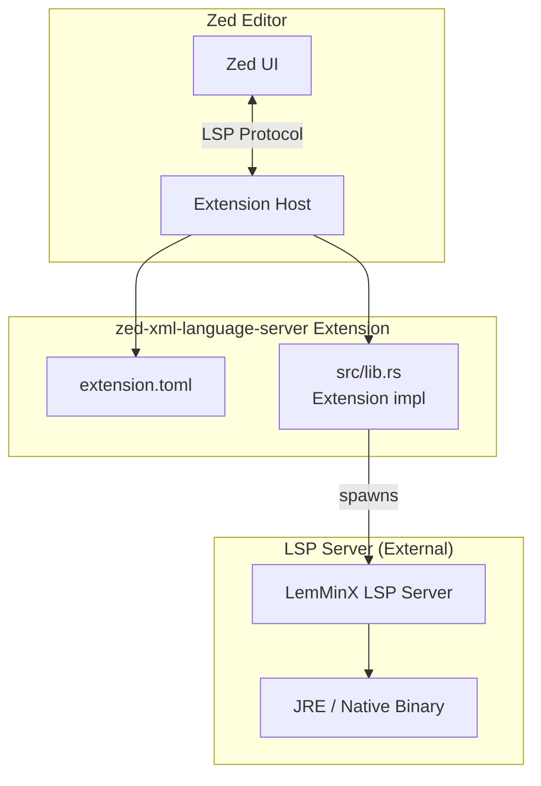

# Zed XML Language Server Extension Design Document

## 1. Overview

### 1.1 Purpose
Provide a Language Server Protocol (LSP) extension for Zed editor to edit XML files. Adopt Eclipse LemMinX as the LSP server to implement XML syntax validation, completion, hover, go-to-definition, formatting, and other features.

### 1.2 Technology Choices
| Component | Technology | Rationale |
|-----------|------------|-----------|
| LSP Server | **Eclipse LemMinX** | Mature XML LSP implementation, supports XSD/DTD validation, rich features |
| Extension Runtime | **Rust + zed_extension_api** | Official Zed extension API, WASM support, type safety |
| Build System | **Nix Flake** | Reproducible dev environment, cross-platform support |
| Binary Distribution | **Dynamic download from GitHub Releases** | Same pattern as zed-rumdl, no binary bundling |

### 1.3 Supported Features (provided by LemMinX)
- ✅ Syntax validation (XML well-formedness)
- ✅ Schema validation (XSD, DTD)
- ✅ Element/attribute completion (schema-based)
- ✅ Hover information (schema-based)
- ✅ Document symbols (outline)
- ✅ Highlighting (same element)
- ✅ Rename refactoring
- ✅ Folding (tags, region comments)
- ✅ Formatting
- ✅ Document links
- ✅ Code actions

---

## 2. Architecture

### 2.1 Overall Structure



### 2.2 Binary Resolution Strategy (following zed-rumdl)

Priority order:
1. **User-configured path** (`lsp.lemminx.binary.path`)
2. **`lemminx` command in PATH**
3. **Auto-download from GitHub Releases** (fallback)

```rust
// Download target asset naming convention (LemMinX native binary)
lemminx-{os}-{arch}-{version}
// Example: lemminx-linux-x86_64-0.11.0, lemminx-macos-aarch64-0.11.0
```

> **Note**: LemMinX GitHub Releases may not include native binaries. Fallback: fetch uber JAR from Maven Central, generate native-image locally, or bundle JRE.

---

## 3. Repository Structure

```
zed-xml-language-server/
├── .github/
│   └── workflows/
│       ├── ci.yml              # fmt, clippy, test, wasm build
│       ├── publish.yml         # Tag push updates zed-industries/extensions
│       └── release-drift.yml   # Weekly: LemMinX release asset naming check
├── flake.nix                   # Nix dev environment definition
├── flake.lock
├── Cargo.toml                  # Rust package definition
├── Cargo.lock
├── extension.toml              # Zed extension manifest
├── LICENSE                     # MIT (extension code) / EPL-2.0 (LemMinX notice)
├── README.md
├── Makefile                    # Development task unification
├── src/
│   └── lib.rs                  # Extension implementation (LSP command, download, etc.)
```

# 4. Publishing & Distribution Flow

### 4.1 Versioning
- **SemVer** compliant: `MAJOR.MINOR.PATCH`
- Extension version ≠ LemMinX version (managed independently)
- Examples: `0.1.0` (initial), `0.2.0` (settings added), `1.0.0` (stable)

### 4.2 Publishing Procedure
1. Verify functionality on `main` branch
2. `git tag v0.x.x && git push origin v0.x.x`
3. GitHub Actions `publish.yml` runs automatically:
   - Updates `zed-industries/extensions` submodule
   - Updates `extensions.toml` version
   - Creates upstream PR

### 4.3 Pre-Release Checks (`release-drift.yml` weekly)
- Verify latest LemMinX release
- Detect asset naming convention changes
- Alert on breaking changes

---

## 5. Known Issues & Mitigations

| Issue | Impact | Mitigation |
|-------|--------|------------|
| **No native binaries in LemMinX GitHub Releases** | High | Fetch uber JAR from Maven Central + local GraalVM native-image generation, or bundle JRE |
| **Java dependency (JRE required)** | Medium | Prefer native binary, fallback to JRE. Nix flake auto-resolves for dev |
| **Initial download latency** | Medium | Background download, progress indication, caching |
| **Windows native-image constraints** | Low | Default to JRE on Windows, native optional |

---

## 6. Implementation Priority

### Phase 1: MVP (Minimal Viable)
- [ ] `extension.toml`, `Cargo.toml` basic structure
- [ ] `src/lib.rs`: Binary resolution (PATH only), LSP command launch
- [ ] Nix flake dev environment
- [ ] Local `zed --foreground` verification

### Phase 2: Auto-Download & Configuration
- [ ] Auto-download from GitHub Releases / Maven Central
- [ ] Platform-specific asset name generation
- [ ] User settings (`lsp.lemminx.*`) support
- [ ] Initialization options & workspace configuration

### Phase 3: Native Binary & Optimization
- [ ] GraalVM native-image generation script (CI integration)
- [ ] Upload native binaries to own GitHub Releases
- [ ] Startup optimization (binary caching, lazy initialization)

### Phase 4: Quality & Publishing
- [ ] Complete CI/CD pipeline
- [ ] Extended tests (integration tests)
- [ ] Documentation (README, CHANGELOG)
- [ ] zed-extensions publication PR

---

## 7. References

- [Zed Language Extensions](https://zed.dev/docs/extensions/languages)
- [Zed Developing Extensions](https://zed.dev/docs/extensions/developing-extensions)
- [zed-rumdl Repository](https://github.com/rvben/zed-rumdl)
- [Eclipse LemMinX](https://github.com/eclipse-lemminx/lemminx)
- [LemMinX Features](https://github.com/eclipse-lemminx/lemminx/blob/main/docs/Features.md)
- [LemMinX Extensions](https://github.com/eclipse-lemminx/lemminx/blob/main/docs/LemMinX-Extensions.md)
- [zed_extension_api crate](https://crates.io/crates/zed_extension_api)

---

## 8. Next Actions

1. **Review & approve this design document**
2. **Repository initialization** (`cargo new`, `flake.nix` creation)
3. **Start Phase 1 implementation** (MVP)

---

*Created: 2026-10-11*
*Author: Jcode Assistant*
